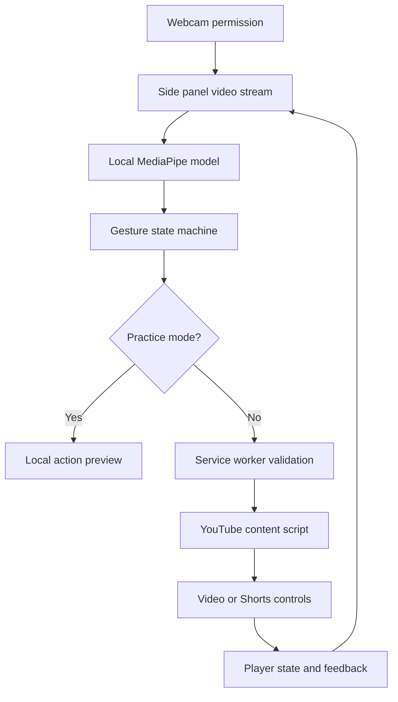

# Architecture and implementation notes

## Data flow

No camera frames cross the extension messaging boundary. The worker receives only action names, sanitized settings, and a target tab ID. The model is Google's pretrained MediaPipe model, not a model trained specifically for this project.

## Why a side panel

A toolbar popup normally disappears as soon as focus moves back to the page. A side panel can remain visible beside YouTube, keeping the preview, stream, controls, and feedback together. The side panel owns the camera and explicitly releases it on Stop and on hide/unload. A separate setup page lets the user grant camera permission if a browser version refuses the prompt inside the side panel.

## Boundaries

| Component | Responsibility |
| --- | --- |
| Panel | UI, camera permission/selection/lifecycle, model loading, frame scheduling, settings, and feedback |
| Gesture engine | Pure temporal logic: confidence, hold, cooldown, neutral reset, and normalized swipe distance |
| Service worker | Sender validation, action allowlist, exact YouTube origin checks, active/focused target checks, and message routing |
| Content script | Find the visible video, apply standard HTMLMediaElement operations, scroll/click Shorts controls, return outcomes |

The content script runs in Chrome's isolated world. It accesses the shared DOM and standard media-element APIs, not YouTube's internal JavaScript objects. No page script injection, broad `scripting` permission, or page-to-extension `postMessage` bridge is needed.

The service worker is stateless. Each request includes its target tab ID, so worker suspension does not erase gesture sessions. Commands are serialized in the panel. The frame loop stops accumulating evidence when controls are paused or the target is not ready.

## Gesture state machine

The model returns a canned pose, score, and 21 landmarks. A pure engine consumes these values and a monotonic timestamp:

1. Reject low-confidence and unknown poses.
2. For static gestures, require a stable pose for the configured duration (550 ms by default).
3. On recognition, issue one action and latch that pose. Brief missing/competing classifications do not immediately rearm it.
4. Require a neutral interval of at least 260 ms, or a different completed pose, before repeating that pose.
5. Enforce the global cooldown even across pose changes.
6. For `Pointing_Up`, track the palm centroid across four landmarks, correcting horizontal coordinates for the preview mirror setting.
7. A swipe must exceed the configured normalized distance within 850 ms, take at least 100 ms, have a dominant axis, and avoid implausibly large single-frame jumps.
8. Reset partial evidence across camera/frame stalls exceeding 300 ms.

Open-palm play and fist pause are idempotent actions. Mute is a deliberate toggle protected by the temporal state machine. This reduces unintended rapid play/pause toggling.

## Media controls

- Video choice is based on visible on-screen area, filtering hidden/preloaded video elements.
- Seeking honors ordinary video bounds and seekable live-stream DVR ranges, including gaps.
- Speed is limited to 0.25×–2× in quarter-speed steps.
- Scrolling uses the current page's viewport.
- Shorts first tries visible, enabled next/previous buttons by ID or accessible label; then tries the adjacent reel renderer.
- Video play errors surface an instruction to interact with the player once, respecting browser autoplay policy.
- The visible feedback toast is isolated in a shadow root and uses text content, not HTML from the page.

## Privacy and permissions

`sidePanel` hosts the UI. `storage` remembers validated preferences in local extension storage. The only host permission is `https://www.youtube.com/*`, used for the content script and YouTube tab metadata.

Camera access is requested by `getUserMedia({ video: ..., audio: false })` after the user presses Start. There is no microphone request, camera recording, analytics, frame storage, external inference request, or cookie/history access.

All runtime code, WASM, and model bytes ship with the extension. MV3 CSP permits local scripts and `wasm-unsafe-eval` for WebAssembly, but not remote executable code or general JavaScript `eval`. `connect-src 'self'` prevents accidental outbound model/inference fetches from extension pages. Inline style permission supports dynamic progress/mirror styling; inline JavaScript remains disallowed.

## Performance and future iterations

Capture prefers 640×480 and up to 30 FPS; recognition is capped at 15 FPS and processes only new video frames. One hand is tracked. CPU inference prioritizes compatibility. Timing displayed in the UI is measured, not a advertised benchmark.

Useful follow-ups: worker-based inference with a frame-transfer/backpressure strategy; a collected, consented gesture evaluation dataset; broader YouTube layout/localization coverage; customizable mappings; accessibility/user studies; and Chrome Web Store packaging. None of these are required to run this prototype.
